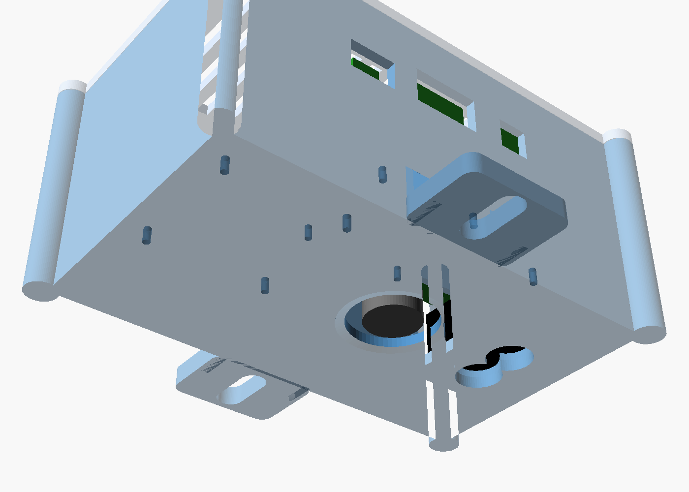

# Front unit housing (bench / field-test)

A 3D-printed box for the front camera unit in [plans/front-camera-unit.md](../../plans/front-camera-unit.md): the OV9281 camera, the ROCK 4SE, the TM171 and the TF-Luna in one rigid body, looking down at the ground. It is a box with a vented lid for bench work and dry-weather drive tests, not the sealed tractor unit: there's no gasket and no window, and the lens looks out through an open aperture.

| | |
|---|---|
|  |  |

Section through the camera axis (orange: the lens's 148° diagonal field of view, which clears the floor):

## Files
- `dims.scad`: every dimension of the bought parts, with its source: datasheets, Radxa's drawing, SYD's STEP models, caliper readings (dated). The few figures read off a drawing's proportions are marked "estimate".
- `front_unit.scad`: the layout, the printed parts (`base`, `lid`, `tap_test`) and dummy models of the bought parts. The `part` variable selects what to draw: `assembly`, `open`, `section`, or a printed part. Its echo shows the box size, the FPC length and the camera–TF-Luna offset. Asserts stop the render if the FPC is too short or the openings run into each other.
- `check.sh`: checks every printed part against every bought part, and the bought parts against each other, for overlaps.
- `export.sh`: writes `stl/*.stl` (each checked to be a clean solid) and `img/*.png`.
- `stl/`: `base.stl`, `lid.stl`, `tap_test.stl`, ready to slice.

OpenSCAD 2021.01 (`winget install OpenSCAD.OpenSCAD`). Run the scripts from Git Bash: `bash hardware/front_unit/check.sh`, then `bash hardware/front_unit/export.sh`.

## Layout
Axes: z up, away from the ground. x runs along the box from the TM171 end to the TF-Luna / RJ45 end. Outside, about 116 × 68 × 59 mm, plus 21 mm for each mounting ear.

- **Floor (faces the ground):**
  - **TM171** in a pocket on a 3 mm platform, case up. Its pin edge faces the camera, and a slot under the pin row leaves room for soldered header pins.
  - **Camera**, PCB on four 22.5 mm bosses, lens down. An L-shaped corner outside each PCB corner (0.3 mm clear, 1.5 mm above the PCB's underside) lines the board up with the housing. The lens front is 0.5 mm above the floor's underside, in a Ø22 hole (`cam_focus_d`): wide enough to grip the Ø14 lens barrel with fingertips or pliers and turn it to focus with the camera in place. The floor never enters the image.
  - **TF-Luna** lens face down on a 3 mm pad, its lens rims in their own opening, so it looks out through no window, as its manual asks. Its ears are at its back (connector side), so two 10 mm standoffs come up from the pad to them. The ear holes are on the lens centreline (user, 2026-11-25), 9 mm from the camera-side edge. The standoffs are trimmed 0.3 mm clear of its body, which leaves about 0.85 mm of wall beside the screw hole on that side. Its cable leaves on the side towards the camera, so there is a 6.5 mm gap between the camera PCB and the TF-Luna body (`tfl_cable_gap`, 5 mm more than before, 2026-11-26). The lens edge faces the camera, so the beam is parallel to the optical axis and **31.5 mm from it in x** (± 5.25 mm in y for emitter / receiver).
- **ROCK 4SE** above them on four posts, components up, with its underside 35 mm above the floor's underside. The RK3399, LPDDR4, eMMC socket and M.2 slot are on its underside; the RK3399 sits right above the camera. That leaves 5 mm between them and the camera's FPC connector. Its RJ45 / USB end has a window in the end wall. USB-C, HDMI and audio get cutouts in the long wall, sized for the plugs.
- **Camera FPC (150 mm):** from the camera's connector, on its edge towards the TM171, over the TM171, up through the gap at the board's uSD end, then over the board to the CSI connector. The routed length is about 104 mm, leaving about 46 mm for folds. The model asserts 20 mm of slack.
- **Wires:** the TM171 and TF-Luna go to UARTs on the 40-pin header, which sits along the long wall with a 6 mm gap for the jumpers.
- **Lid:** all the vents, slots 3 mm wide running across the box (along y) over the whole board. The base walls have no vents (2026-11-26); the only other openings are the port cutouts and the RJ45 / USB window. No fan and no heatsink for now (2026-11-25, winter). The RK3399 is on the board's underside, so if it needs cooling later, the option is to turn the board over (SoC up under the lid). The camera connector would then face the camera and the header the TM171 / TF-Luna, and the RJ45 / USB stacks would hang down over the TF-Luna.
- **Mounting:**
  - two ears at floor level with M6 slots, for an angle or bracket that comes down beside the box;
  - **or** two M5 screws, 30 mm apart, threaded into the outside of the header-side wall, 20 mm above the floor's underside, for a flat plate.

## TM171 model
The TM171's dimensions come from SYD's STEP models, which arrive as two files (core and baseboard) in unrelated coordinates. `tm171_combine.py` puts them together and writes `external/syd_dynamics/TransducerM_TM171_Combined.step` / `.stl`; that folder is not in the public repo. It needs OCP (`pip install cadquery-ocp`), and is run from the repo root as `python -I hardware/front_unit/tm171_combine.py external/syd_dynamics`. The combined model was checked against the base: it doesn't intersect the pocket or the platform.

Measured on the combined model:
- baseboard 34 × 40 × 1.6 mm, aluminium core 30 × 26 × 11 mm, 12.6 mm overall;
- mounting holes Ø2.1 on 30 × 31 mm, centred 0.41 mm towards the pin edge;
- 5 header holes 2.44 mm in from the pin edge;
- USB-C on the top side at the opposite edge.

## TM171 axes
`TM171 +X →` is engraved on the header-side wall. The TM171 lies flat, case up (its z away from the ground), with its x axis along that arrow. Mounted with the arrow pointing forward and the floor level, the TM171 is level with x forward, the 0 / 0 / 0 case of the web settings `front_imu_roll_deg` / `_pitch_deg` / `_yaw_deg`. Any other direction is a yaw about z (arrow pointing left: 90° or −90°, depending on the sign convention in `front_imu.c`; check it on the bench with a rotation by hand).

The camera's FPC connector edge faces the TM171 end (−x). Set the image direction (`--cam-yaw`, or the Pico's camera setting) to match.

## Fasteners (BOM)
No heat-set inserts: every screw threads straight into a printed pilot hole (2026-11-25). The camera, TM171 and TF-Luna take no screws at all: printed pins go through their M2 holes and are heat-staked (2026-11-26, below).

| Joint | Parts |
|---|---|
| Lid → base | 4 × M3 × 10 through the lid, into Ø2.5 holes 9 mm deep in the corner posts |
| ROCK 4SE → posts | 4 × M2.5 × 8 self-tapping into Ø2.1 |
| Camera → bosses | 4 printed pins through its holes, heat-staked |
| TF-Luna → standoffs | 2 printed pins on the 10 mm standoffs, through its ears, heat-staked |
| TM171 → platform | 4 printed pins through the baseboard's corner holes (30 × 31 mm), heat-staked |
| Bracket | 2 × M6 through the ear slots, or 2 × M5 into Ø4.2 holes 12 mm deep in the wall (screw length: bracket + up to 10 mm) |

Pilot holes are about 0.85 × the thread size (M2 Ø1.7, M2.5 Ø2.1, M3 Ø2.5, M5 Ø4.2). That is a common rule for machine screws cut into PETG, not a vendor figure. **Print `tap_test.stl` first.** It has one row per size, with holes at −0.1 / nominal / +0.1 mm, 10 mm deep. Drive a screw into each: the right hole grips firmly without the plastic splitting or the screw stalling. Set that size as `tap_m2` / `tap_m25` / `tap_m3` / `tap_m5` in `dims.scad`, then run `check.sh` and `export.sh`. Plastic threads wear: don't tighten them hard, and on a hole you'll open often (the lid), stop as soon as the screw seats.

## Print (Bambu Lab P1S, PETG)
Bambu Studio settings. Print `tap_test.stl` **with the same settings** as the box: a hole size picked on the coupon only carries over if both print the same way.

**Before you start**
- All three STLs are already in their print orientation: import them and don't rotate. `base` prints floor down (the ears lie on the plate), `lid` top down (lip up), the coupon flat.
- Base and lid fit side by side on one 256 × 256 plate.
- Print `tap_test.stl` first, about 15 minutes.

**Printer and filament**
- **Printer:** P1S, 0.4 mm nozzle.
- **Process profile:** "0.20mm Standard @BBL P1S".
- **Filament:** "Bambu PETG Basic", or "Generic PETG", with its default temperatures.
- **Plate:** textured PEI. On a smooth PEI plate, use glue stick as a release layer, because PETG bonds to bare smooth PEI hard enough to tear it.

**Strength tab**
- **Wall loops: 4.** This is the setting that matters most: four walls give each pilot hole about 1.7 mm of solid plastic for the screw to cut into.
- **Top shell layers:** 5. **Bottom shell layers:** 4.
- **Sparse infill:** 30 %, gyroid. The bosses and posts are small, so they come out solid anyway.

**Support: off.** These spans bridge, with a little sag on their underside, which doesn't matter because no edge there is a fit:
- the top of the RJ45 / USB window (about 54 mm, the longest);
- the tops of the port cutouts;
- the 0.5 mm cone around the lens.

**Leave at the profile's default**
- **X-Y hole compensation: 0.** The coupon tunes the holes instead. If you change it later, print the coupon again. PETG prints holes slightly undersize, which is why the coupon tries −0.1 / 0 / +0.1 mm.
- **Elephant foot compensation:** default. The base sits on its floor, and nothing on the first layer has to fit.
- Cooling, speeds and seam.

**Enclosure and heat**
- For PETG, crack the P1S top lid open if you see stringing or heat creep, otherwise leave it closed.
- PETG softens at about 70–80 °C, so the box is fine on the bench and in shade. For a summer field mount in direct sun, print it in ASA instead, with the P1S door and lid closed.

**After the coupon:** drive each screw into its −0.1 / 0 / +0.1 holes and pick the one that grips firmly without splitting the plastic. Set it as `tap_m2` / `tap_m25` / `tap_m3` / `tap_m5` in `dims.scad`, run `check.sh` and `export.sh`, then print `base` and `lid`. If the nominal sizes are fine, print them straight away.

## Sources of the ROCK 4SE layout
- Radxa's product brief rev 1.8, p.5 (mechanical drawing, a vector drawing read with pymupdf), and the V1.53 schematic, p.5. The schematic shows that J8203 is the camera connector (MIPI_RX0, CAM_MCLK); J8204 is the display connector.
- The brief's top view is drawn as seen from below. Checked against the board photo: the RJ45 sits at the power-edge corner, as on a Pi 4.
- Heights: the USB stack (16 mm) and RJ45 (14 mm) are the user's readings. The user also set 5 mm as enough clearance under the board. The HDMI, audio and camera connector heights are estimates. Positions are all in `dims.scad`.

## Check before printing
- **Pilot holes:** print `tap_test.stl` and set the `tap_*` sizes.
- After any change in `dims.scad`: `bash check.sh`, then `bash export.sh`.

## Heat-staking the pins
The camera, TM171 and TF-Luna sit on printed pins (Ø1.8, `stake_d`) that go through their M2 holes (Ø2.1–2.2). Each pin stands 2 mm above the part (`stake_len`). Melting that 2 mm into a small head holds the part down. To go back to M2 screws, set `m2_fix = "screw"` in `dims.scad` and export again: the pins become Ø1.7 pilot holes.

- **Iron:** about 200–220 °C, with a clean flat or chisel tip.
- **Staking:** press straight down on the pin top for 2–3 s until it spreads into a head about 3–4 mm across, a little wider than the hole. Hold it still for a second while it sets.
- **Heat:** keep the tip on the pin, not the part. Touch each pin once and let it cool before the next one on the same part. The camera PCB and the TF-Luna's plastic ears don't like a long dwell.
- **Removing a part:** cut or file the heads off. Print a new base (or set `m2_fix = "screw"`) to fit it again.

## Assembly
1. Pre-cut the threads: run each screw (ROCK 4SE, lid, bracket) into its hole once and back out, before any part goes in.
2. Solder a 5-pin header to the TM171 (RXD, TXD, 5V, GND). Set it on the four pins in the pocket, header towards the camera, `+X` matching the arrow on the wall, and stake the pins.
3. Plug the FPC into the camera. Focus it first, on the bench, with `flow`'s preview page: the lens is hard to reach once it's staked. Then set it on the four boss pins, FPC edge towards the TM171, and stake them.
4. Set the TF-Luna lens down into its opening, with its ears on the standoff pins and connector up, and stake them. Pin 5 goes to GND for I2C (below, "Header wiring"); save its settings over UART once before that.
5. Run the jumpers from the TM171 and the TF-Luna up along the header-side wall. Lay the FPC over the TM171 and up past the board's uSD end.
6. Screw down the ROCK 4SE, then plug in the FPC and the jumpers.
7. Lid on with 4 × M3.

## Header wiring

The ROCK 4SE's 40-pin header has two UARTs (brief p.7): UART2 on pins 8/10 is the debug console of U-Boot and Linux (`stdout-path` `serial2:1500000`), and UART4 on pins 19/21 shares its pins with SPI1. So the TM171 takes UART4 and the TF-Luna goes on I2C7 (pins 3/5), and the console stays free. Pin names from Radxa's archived ROCK 4 GPIO wiki (wiki.radxa.com/Rock4/hardware/gpio, the ROCK 4C+ v1.2 table); the I2C7 and UART4 pins match dietpi's overlay readmes.

| Sensor pin | Header pin | |
|---|---|---|
| TM171 1 RXD | 19, UART4_TXD (GPIO1_B0) | `/dev/ttyS4`, 921600 |
| TM171 2 TXD | 21, UART4_RXD (GPIO1_A7) | |
| TM171 3 VCC 5 V | 4, +5 V | |
| TM171 4 GND | 20, GND | 5 is a second GND, not needed |
| TF-Luna 1 +5 V | 2, +5 V | no reverse-polarity protection: check before power-on |
| TF-Luna 2 SDA | 3, I2C7_SDA (GPIO2_A7) | `/dev/i2c-7`, address 0x10 |
| TF-Luna 3 SCL | 5, I2C7_SCL (GPIO2_B0) | |
| TF-Luna 4 GND | 9, GND | |
| TF-Luna 5 | to its own pin 4 (GND) | I2C mode, read at power-on |
| TF-Luna 6 data ready | 7, GPIO2_B3, through 1 kΩ | `gpiochip2:11` |

The whole header, to find the pins by number (odd pins in one row, even in the other; pin 1 is marked on the board, so count from there). Same source as above: the names of the unused pins 12, 13, 36, 38 and 40 differ on early ROCK 4C+ boards and are not checked on the 4SE.

| Pin | Name | Used by | | Pin | Name | Used by |
|---|---|---|---|---|---|---|
| 1 | +3.3 V | | | 2 | +5 V | TF-Luna 1 |
| 3 | I2C7_SDA (GPIO2_A7) | TF-Luna 2 | | 4 | +5 V | TM171 3 |
| 5 | I2C7_SCL (GPIO2_B0) | TF-Luna 3 | | 6 | GND | |
| 7 | GPIO2_B3 | TF-Luna 6, 1 kΩ | | 8 | UART2_TX, console (GPIO4_C4) | |
| 9 | GND | TF-Luna 4 | | 10 | UART2_RX, console (GPIO4_C3) | |
| 11 | GPIO4_C2 (PWM0) | | | 12 | GPIO4_A3 (I2S1_SCLK) | |
| 13 | GPIO4_C6 (PWM1) | | | 14 | GND | |
| 15 | GPIO4_C5 (SPDIF_TX) | | | 16 | GPIO4_D2 | |
| 17 | +3.3 V | | | 18 | GPIO4_D4 | |
| 19 | UART4_TX (GPIO1_B0) | TM171 1 | | 20 | GND | TM171 4 |
| 21 | UART4_RX (GPIO1_A7) | TM171 2 | | 22 | GPIO4_D5 | |
| 23 | SPI1_CLK (GPIO1_B1) | | | 24 | SPI1_CS (GPIO1_B2) | |
| 25 | GND | | | 26 | ADC_IN0 (1.8 V) | |
| 27 | I2C2_SDA (GPIO2_A0) | | | 28 | I2C2_SCL (GPIO2_A1) | |
| 29 | GPIO2_B2 (I2C6_SCL) | | | 30 | GND | |
| 31 | GPIO2_B1 (I2C6_SDA) | | | 32 | GPIO3_C0 (3.3 V) | |
| 33 | GPIO2_B4 | | | 34 | GND | |
| 35 | GPIO4_A5 | | | 36 | GPIO4_A4 | |
| 37 | GPIO4_D6 | | | 38 | GPIO4_A6 | |
| 39 | GND | | | 40 | GPIO4_A7 | |

- **3.0 V header:** the ROCK 4's GPIOs are 3.0 V (the wiki; pin 32 alone is 3.3 V), the sensors' logic 3.3 V. The I2C lines are open-drain with 4.7 kΩ pull-ups to 3.0 V on the board, so they are fine. The TF-Luna's pin 6 drives 3.3 V: the 1 kΩ limits the current into the GPIO's clamp diode. The TM171's TXD level isn't in its datasheet ("UART TTL 3.3V compatible TTL 5.0V"): measure it idle before connecting pin 21, and give it a 1 kΩ in series too.
- **Device tree:** `overlays=i2c7 uart4` in `/boot/dietpiEnv.txt` (DietPi's `rockchip-rk3399-i2c7` and `-uart4`; UART4 turns SPI1 off), then a reboot. On dietpi: set 2026-11-25 (the old file kept as `/boot/dietpiEnv.txt.bak-2026-11-25`), and after the reboot on 2026-11-26 `/dev/i2c-7` (rk3x-i2c, group `i2c`) and `/dev/ttyS4` (group `dialout`) are there; the Linux console stays `tty1`. Nothing wired to them yet. `dietpi` was added to the `i2c` group the same day for `/dev/i2c-7` (`plugdev` already gives it the GPIO chips).
- **Before the TF-Luna goes to I2C:** on a USB-serial adapter with pin 5 open, `pi/flow/build/tfluna --port /dev/ttyUSB0 --save --seconds 2`, which saves its filters off (the I2C registers can't set them). **Done 2026-11-25** for our sensor (firmware 3.6.0, on a CH340 adapter on dietpi): the save answered status 0, and after a soft reset (ID 0x02) the read-back by ID 0x3F gave filter bitmap `00` (both off; the default is `03`) and 100 Hz. The output format and enable IDs gave no answer to 0x3F. Then pin 5 to GND and a power cycle. Bench check: `pi/flow/build/tfluna --i2c /dev/i2c-7 --drdy gpiochip2:11 --seconds 10`, about 100 Hz with no missed results.
- **921600 on UART4:** not yet checked that the RK3399's UART clock makes it exactly; `pi/flow/build/tm171 /dev/ttyS4 --baud 921600 --seconds 10` shows CRC errors if not (ours has 921600 saved in its flash). Until then the TM171 can stay on USB.

### On a Raspberry Pi 5 instead

The Pi 5's debug console has its own 3-pin connector, so no header UART is the console, and RP1 has several more (`uart2-pi5` … `uart4-pi5` overlays). Both sensors can then be on a UART: the TF-Luna keeps the mm format and has its filters set at every start, and needs neither I2C nor the data-ready wire. Not yet wired or tried on a Pi 5; the UART2 pins and the `ttyAMA` names are from memory, to check with `dtoverlay -h uart2-pi5` and `ls /dev/ttyAMA*`.

| Sensor pin | Pi 5 header pin | |
|---|---|---|
| TM171 1 RXD | 8, GPIO14 TXD0 | `/dev/ttyAMA0`, 921600 |
| TM171 2 TXD | 10, GPIO15 RXD0 | |
| TM171 3 VCC 5 V | 4, +5 V | |
| TM171 4 GND | 6, GND | |
| TF-Luna 1 +5 V | 2, +5 V | |
| TF-Luna 2 RXD | 7, GPIO4 TXD2 | `/dev/ttyAMA2`, 115200 |
| TF-Luna 3 TXD | 29, GPIO5 RXD2 | |
| TF-Luna 4 GND | 9, GND | |
| TF-Luna 5 | open | UART mode |
| TF-Luna 6 | not connected | |

The whole header (BCM numbers; pin 1 at the corner end, odd pins on the inner row):

| Pin | Name | Used by | | Pin | Name | Used by |
|---|---|---|---|---|---|---|
| 1 | +3.3 V | | | 2 | +5 V | TF-Luna 1 |
| 3 | GPIO2 (SDA1) | | | 4 | +5 V | TM171 3 |
| 5 | GPIO3 (SCL1) | | | 6 | GND | TM171 4 |
| 7 | GPIO4 (TXD2) | TF-Luna 2 | | 8 | GPIO14 (TXD0) | TM171 1 |
| 9 | GND | TF-Luna 4 | | 10 | GPIO15 (RXD0) | TM171 2 |
| 11 | GPIO17 | | | 12 | GPIO18 | |
| 13 | GPIO27 | | | 14 | GND | |
| 15 | GPIO22 | | | 16 | GPIO23 | |
| 17 | +3.3 V | | | 18 | GPIO24 | |
| 19 | GPIO10 (MOSI) | | | 20 | GND | |
| 21 | GPIO9 (MISO) | | | 22 | GPIO25 | |
| 23 | GPIO11 (SCLK) | | | 24 | GPIO8 (CE0) | |
| 25 | GND | | | 26 | GPIO7 (CE1) | |
| 27 | GPIO0 (ID_SD) | | | 28 | GPIO1 (ID_SC) | |
| 29 | GPIO5 (RXD2) | TF-Luna 3 | | 30 | GND | |
| 31 | GPIO6 | | | 32 | GPIO12 | |
| 33 | GPIO13 | | | 34 | GND | |
| 35 | GPIO19 | | | 36 | GPIO16 | |
| 37 | GPIO26 | | | 38 | GPIO20 | |
| 39 | GND | | | 40 | GPIO21 | |

- **Setup:** `dtparam=uart0=on` and `dtoverlay=uart2-pi5` in `/boot/firmware/config.txt`, the serial login shell off in `raspi-config` (Interface → Serial: no login shell, hardware on), a reboot; the user in `dialout`.
- **Logic:** 3.3 V on the Pi, the same as the sensors, so no series resistors are needed; the TM171's TXD level is still to measure before connecting pin 10.
- **Bench checks:** `pi/flow/build/tm171 /dev/ttyAMA0 --baud 921600 --seconds 10` and `pi/flow/build/tfluna --port /dev/ttyAMA2 --seconds 10`. In `flow` the TM171 on a UART needs `--tm171-baud 921600` (the default is 115200), here or on the ROCK 4SE: `flow ... --tm171 /dev/ttyAMA0 --tm171-baud 921600 --lidar /dev/ttyAMA2`. At 921600 its raw, Status and RPY objects at 800 Hz load the line to roughly 85 % (estimate, from the object sizes).
- **TF-Luna on I2C instead:** pins 3/5 (`dtparam=i2c_arm=on`, `/dev/i2c-1`, 1.8 kΩ pull-ups on the board), pin 6 to a free GPIO such as pin 11 (GPIO17), no resistor: `--lidar-i2c /dev/i2c-1 --lidar-drdy gpiochip0:17`. The header's chip is RP1, `gpiochip0` or `gpiochip4` depending on the kernel (`gpiodetect`).
- **Elsewhere on a Pi 5:** the camera uses Raspberry Pi OS's own `ov9281` driver (`dtoverlay=ov9281,cam0`) through libcamera, so no `--v4l2` and none of `pi/flow/rock4se/`; it needs a 15-to-22-pin camera cable. The box here is laid out for the ROCK 4SE: the Pi 5's ports, camera connectors, power button and cooler differ, so its cutouts and cable runs need checking in `dims.scad` and `check.sh`.

## Open points
- The open aperture lets dust reach the lens, which is acceptable for dry tests. The sealed tractor unit (window, hood, PoE, M12 connectors) is a separate design.
