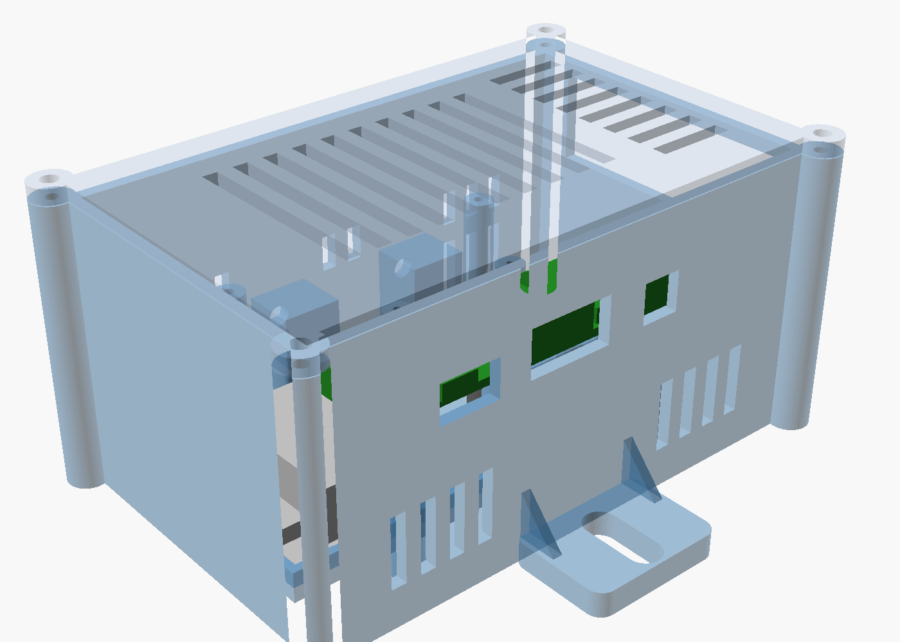
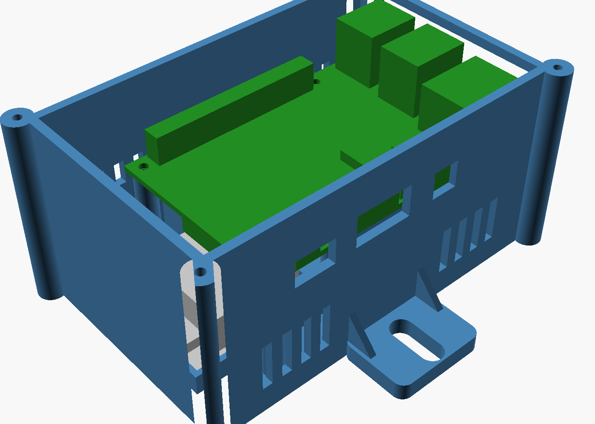
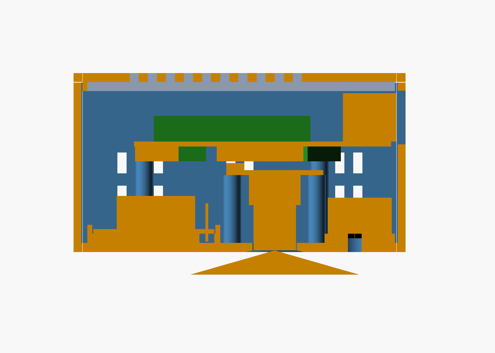

# Front unit housing (bench / field-test)

A 3D-printed box for the front camera unit in [plans/front-camera-unit.md](../../plans/front-camera-unit.md): the OV9281 camera, the ROCK 4SE, the TM171 and the TF-Luna in one rigid body, looking down at the ground. It is a vented box for bench work and dry-weather drive tests, not the sealed tractor unit: there's no gasket and no window, and the lens looks out through an open aperture.

| | |
|---|---|
|  |  |

Section through the camera axis (orange: the lens's 148° diagonal field of view, which clears the floor):

## Files
- `dims.scad`: every dimension of the bought parts, with its source: datasheets, Radxa's drawing, SYD's STEP models, caliper readings (dated). The few figures read off a drawing's proportions are marked "estimate".
- `front_unit.scad`: the layout, the printed parts (`base`, `lid`, `tap_test`) and dummy models of the bought parts. The `part` variable selects what to draw: `assembly`, `open`, `section`, or a printed part. Its echo shows the box size, the FPC length and the camera–TF-Luna offset. Asserts stop the render if the FPC is too short or the openings run into each other.
- `check.sh`: checks every printed part against every bought part, and the bought parts against each other, for overlaps.
- `export.sh`: writes `stl/*.stl` (each checked to be a clean solid) and `img/*.png`.
- `stl/`: `base.stl`, `lid.stl`, `tap_test.stl`, ready to slice.

OpenSCAD 2021.01 (`winget install OpenSCAD.OpenSCAD`). Run the scripts from Git Bash: `bash hardware/front_unit/check.sh`, then `bash hardware/front_unit/export.sh`.

## Layout
Axes: z up, away from the ground. x runs along the box from the TM171 end to the TF-Luna / RJ45 end. Outside, about 110 × 68 × 59 mm, plus 21 mm for each mounting ear.

- **Floor (faces the ground):**
  - **TM171** in a pocket on a 3 mm platform, case up. Its pin edge faces the camera, and a slot under the pin row leaves room for soldered header pins.
  - **Camera**, PCB on four 22.5 mm bosses, lens down. The lens front is 0.5 mm above the floor's underside, inside a Ø14.8 hole with a short cone, so the floor never enters the image.
  - **TF-Luna** lens face down on a 3 mm pad, its lens rims in their own opening, so it looks out through no window, as its manual asks. Its ears are at its back (connector side), so two 10 mm standoffs come up from the pad to them. The ear holes are on the lens centreline (user, 2026-11-25), 9 mm from the camera-side edge. The standoffs are trimmed 0.3 mm clear of its body, which leaves about 0.85 mm of wall beside the screw hole on that side. The lens edge faces the camera, so the beam is parallel to the optical axis and **26.5 mm from it in x** (± 5.25 mm in y for emitter / receiver).
- **ROCK 4SE** above them on four posts, components up, with its underside 35 mm above the floor's underside. The RK3399, LPDDR4, eMMC socket and M.2 slot are on its underside; the RK3399 sits right above the camera. That leaves 5 mm between them and the camera's FPC connector. Its RJ45 / USB end has a window in the end wall. USB-C, HDMI and audio get cutouts in the long wall, sized for the plugs.
- **Camera FPC (150 mm):** from the camera's connector, on its edge towards the TM171, over the TM171, up through the gap at the board's uSD end, then over the board to the CSI connector. The routed length is about 109 mm, leaving about 41 mm for folds. The model asserts 20 mm of slack.
- **Wires:** the TM171 and TF-Luna go to UARTs on the 40-pin header, which sits along the long wall with a 6 mm gap for the jumpers.
- **Lid:** vent slots over the board and the RJ45 end, inlet vents low in both long walls. No fan and no heatsink for now (2026-11-25, winter). The RK3399 is on the board's underside, so if it needs cooling later, the option is to turn the board over (SoC up under the lid). The camera connector would then face the camera and the header the TM171 / TF-Luna, and the RJ45 / USB stacks would hang down over the TF-Luna.
- **Mounting:**
  - two ears at floor level with M6 slots, for an angle or bracket that comes down beside the box;
  - **or** two M5 screws, 30 mm apart, threaded into the outside of the header-side wall, 20 mm above the floor's underside, for a flat plate.

## TM171 model
The TM171's dimensions come from SYD's STEP models, which arrive as two files (core and baseboard) in unrelated coordinates. `tm171_combine.py` puts them together and writes `external/syd_dynamics/TransducerM_TM171_Combined.step` / `.stl`; that folder is not in the public repo. It needs OCP (`pip install cadquery-ocp`), and is run from the repo root as `python -I hardware/front_unit/tm171_combine.py external/syd_dynamics`. The combined model was checked against the base: it doesn't intersect the pocket or the platform.

Measured on the combined model:
- baseboard 34 × 40 × 1.6 mm, aluminium core 30 × 26 × 11 mm, 12.6 mm overall;
- mounting holes Ø2.1 on 30 × 31 mm, centred 0.41 mm towards the pin edge;
- 5 header holes 2.44 mm in from the pin edge;
- USB-C on the top side at the opposite edge.

## TM171 axes
`TM171 +X →` is engraved on the header-side wall. The TM171 lies flat, case up (its z away from the ground), with its x axis along that arrow. Mounted with the arrow pointing forward and the floor level, the TM171 is level with x forward, the 0 / 0 / 0 case of the web settings `front_imu_roll_deg` / `_pitch_deg` / `_yaw_deg`. Any other direction is a yaw about z (arrow pointing left: 90° or −90°, depending on the sign convention in `front_imu.c`; check it on the bench with a rotation by hand).

The camera's FPC connector edge faces the TM171 end (−x). Set the image direction (`--cam-yaw`, or the Pico's camera setting) to match.

## Fasteners (BOM)
No heat-set inserts: every screw threads straight into a printed pilot hole (2026-11-25).

| Joint | Parts |
|---|---|
| Lid → base | 4 × M3 × 10 through the lid, into Ø2.5 holes 9 mm deep in the corner posts |
| ROCK 4SE → posts | 4 × M2.5 × 8 self-tapping into Ø2.1 |
| Camera → bosses | 4 × M2 × 6 self-tapping into Ø1.7 |
| TF-Luna → standoffs | 2 × M2 × 6 self-tapping into Ø1.7, through its ears into the 10 mm standoffs |
| TM171 → platform | 4 × M2 × 5 self-tapping into Ø1.7, through the baseboard's corner holes (30 × 31 mm) |
| Bracket | 2 × M6 through the ear slots, or 2 × M5 into Ø4.2 holes 12 mm deep in the wall (screw length: bracket + up to 10 mm) |

Pilot holes are about 0.85 × the thread size (M2 Ø1.7, M2.5 Ø2.1, M3 Ø2.5, M5 Ø4.2). That is a common rule for machine screws cut into PETG, not a vendor figure. **Print `tap_test.stl` first.** It has one row per size, with holes at −0.1 / nominal / +0.1 mm, 10 mm deep. Drive a screw into each: the right hole grips firmly without the plastic splitting or the screw stalling. Set that size as `tap_m2` / `tap_m25` / `tap_m3` / `tap_m5` in `dims.scad`, then run `check.sh` and `export.sh`. Plastic threads wear: don't tighten them hard, and on a hole you'll open often (the lid), stop as soon as the screw seats.

## Print (Bambu Lab P1S, PETG)
All three STLs are already in their print orientation: import them into Bambu Studio and don't rotate. Base and lid fit on one 256 × 256 plate, side by side.

- **Profile:** "0.20mm Standard @BBL P1S", 0.4 mm nozzle, filament "Bambu PETG Basic" or "Generic PETG".
- **Plate:** textured PEI. On a smooth PEI plate, use glue stick as a release layer, because PETG bonds to bare smooth PEI hard enough to tear it.
- **Strength:** 4 walls, 5 top / 4 bottom layers, 30 % gyroid infill. The bosses and posts are small, so they come out solid anyway.
- **Supports:** off. These spans bridge:
  - the top of the RJ45 / USB window (about 54 mm, the longest);
  - the tops of the port and vent cutouts;
  - the 0.5 mm cone around the lens.

  PETG bridges that far with some sag on the underside. That edge isn't a fit, so it doesn't matter.
- **Order:** print `tap_test.stl` first, about 15 minutes.
- `base`: floor down; the ears lie on the plate.
- `lid`: top down, lip up.
- **PETG and holes:** PETG prints holes slightly undersize, which is why the coupon tries −0.1 / 0 / +0.1 mm.
- **Heat:** PETG softens at about 70–80 °C, so the box is fine on the bench and in shade. For a summer field mount in direct sun, print it in ASA instead, with the P1S door and lid closed.

## Sources of the ROCK 4SE layout
- Radxa's product brief rev 1.8, p.5 (mechanical drawing, a vector drawing read with pymupdf), and the V1.53 schematic, p.5. The schematic shows that J8203 is the camera connector (MIPI_RX0, CAM_MCLK); J8204 is the display connector.
- The brief's top view is drawn as seen from below. Checked against the board photo: the RJ45 sits at the power-edge corner, as on a Pi 4.
- Heights: the USB stack (16 mm) and RJ45 (14 mm) are the user's readings. The user also set 5 mm as enough clearance under the board. The HDMI, audio and camera connector heights are estimates. Positions are all in `dims.scad`.

## Check before printing
- **Pilot holes:** print `tap_test.stl` and set the `tap_*` sizes.
- After any change in `dims.scad`: `bash check.sh`, then `bash export.sh`.

## Assembly
1. Pre-cut the threads: run each screw into its hole once and back out, before any part goes in.
2. Solder a 5-pin header to the TM171 (RXD, TXD, 5V, GND). Screw it into the pocket, pins towards the camera, `+X` matching the arrow on the wall.
3. Plug the FPC into the camera. Screw the camera onto its bosses, FPC edge towards the TM171. Focus first, on the bench, with `flow`'s preview page.
4. Set the TF-Luna lens down into its opening and screw its ears to the standoffs, connector up. Leave pin 5 open for UART.
5. Run the jumpers from the TM171 and the TF-Luna up along the header-side wall. Lay the FPC over the TM171 and up past the board's uSD end.
6. Screw down the ROCK 4SE, then plug in the FPC and the jumpers.
7. Lid on with 4 × M3.

## Open points
- **UARTs on the ROCK 4SE:** the 40-pin header has only two (brief p.7). UART2 is the debug console (pins 8/10); UART4 is on pins 19/21, shared with SPI1. Carrying the TM171 (921600 baud) and the TF-Luna (115200) means freeing UART2 from the console and enabling both in the device tree. Until then, both can stay on USB on the bench.
- The open aperture lets dust reach the lens, which is acceptable for dry tests. The sealed tractor unit (window, hood, PoE, M12 connectors) is a separate design.
